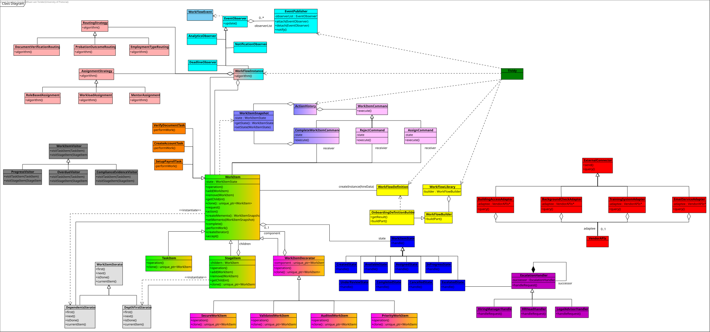

# 🏫 TIVIDY — Workflow Management System

COS 214 Project — *From research to a working engine*

<p align="center">
  
</p>

---

## 👥 Team

| Name | Student Number |
|---|---|
| Aidan du Bruyn | 25040104 |
| Connor Human | 22752154 |
| Ishmael Ngwasheng | 24642542 |
| Jay Macaskill | 25198387 |
| Keval Govind | 24904407 |
| Ruan van Tonder | 25284607 |
| Thabo Ngwabi | 24742512 |

---

## 🧭 The Two Phases

This repository is the story of one project told in two phases.

**Phase 1** is where we started: research and design with no implementation. A blueprint that is a bit rough around the edges and open to change as we go along. It has fifteen GoF patterns, a scenario about employee onboarding, and diagrams modelling our concept without an engine to base them off of yet. It is not yet perfect. Some names will change, and after adjustments our diagrams may become inconsistent.

**Phase 2** is where we're going: a working C++11 implementation of TIVIDY. That phase hasn't started yet. When it does, this README will grow a second half.

This README is split into the two phases. Phase 1 is complete as of October 6th 2026. Phase 2 follows that.

---

## 🌱 Phase 1 (Practical 6)

<p align="center">
  
  <br/>
</p>

For the full Phase 1 PDF with every required task, click <a href="docs/archive/COS_214_PA_6.pdf">here</a>.

### 🏗️ What is TIVIDY?

**TIVIDY** is a generic workflow management system. It stores reusable **workflow definitions** and creates independent **workflow instances** from them. It coordinates work, applies routing and assignment rules, records history, and integrates with external systems — all without being rewritten for each new process.

TIVIDY is not tied to any single scenario. The scenario we chose — **employee onboarding** — uses TIVIDY; it does not define it.

Phase 1 asked us to research the problem domain, define the system scope and design rationale, and produce a complete set of UML diagrams and design pattern justifications. No implementation was required.

### 🧩 The Scenario — Employee Onboarding

The onboarding scenario begins when a candidate accepts an offer and ends when the new hire is fully onboarded. It involves:

- **11 roles** — New Hire, Hiring Manager, HR Coordinator, IT Technician, Payroll Officer, Mentor, HR Head, Legal Advisor, Security Officer, Facilities Coordinator, plus TIVIDY-level Administrator and Auditor roles
- **6 major phases** — Pre-boarding, Compliance checks, Provisions, First week, Training, Completion
- **5 decision points** — Probation outcome, Document verification, Mentor assignment, Employment type, Provision sign-off
- **Multi-level escalation** — A second probation extension request escalates to the HR Head
- **5 possible outcomes** — Completed, Completed with extension, Terminated, Withdrawn, Cancelled
- **5 external systems** — Email/calendar, Background check, Building access, Training system, HR analytics

The scenario is complex enough to exercise the generic engine without overwhelming it.

### 🎨 Design Patterns

Fifteen GoF patterns appear in the Phase 1 design. They are not listed to hit a number — each one is tied to a real workflow-management problem:

| # | Pattern | What it solves in TIVIDY |
|---|---|---|
| 1 | **Composite** | Nested onboarding work (IT setup, training modules, provisions stage) treated uniformly |
| 2 | **Decorator** | Optional extras (validation, security, audit, priority) added per task without subclasses |
| 3 | **Adapter** | External systems (email, background checks, building access, training) isolated behind a stable interface |
| 4 | **Facade** | One stable entry point into a five-subsystem workflow start |
| 5 | **Prototype** | Cloning a definition template into independent instances with deep copies |
| 6 | **Builder** | Step-by-step construction and validation of a definition tree |
| 7 | **State** | Work-item lifecycle (Created → Available → Assigned → … → Completed/Cancelled) with valid transitions |
| 8 | **Strategy** | Separable routing (`RoutingStrategy`) and assignment (`AssignmentStrategy`) policies |
| 9 | **Observer** | Multiple unrelated reactions to one event (routing, notifications, analytics, deadlines) |
| 10 | **Command** | Actions as undoable objects recorded in history |
| 11 | **Memento** | Pre-change snapshots for undo without breaking encapsulation |
| 12 | **Template Method** | Guaranteed ordering of complete → snapshot → work → transition → record → publish |
| 13 | **Iterator** | Traversal of running structures without exposing storage |
| 14 | **Visitor** | Progress, overdue, and compliance reports over a stable item hierarchy |
| 15 | **Chain of Responsibility** | Escalation paths (Hiring Manager → HR Head → Legal Advisor) configurable per request |

A full participant mapping table, collaboration descriptions, and justifications are in the Phase 1 PDF.

### 📐 Diagrams

| File | Diagram |
|---|---|
| <a href="docs/img/pa6/activity-scenario.svg">activity-scenario.svg</a> | Scenario-specific Activity Diagram (employee onboarding end-to-end) |
| <a href="docs/img/pa6/activity-generic-execution.svg">activity-generic-execution.svg</a> | Generic Activity Diagram — workflow execution from creation to final outcome |
| <a href="docs/img/pa6/activity-generic-assignment.svg">activity-generic-assignment.svg</a> | Generic Activity Diagram — work assignment and escalation |
| <a href="docs/img/pa6/class-diagram.svg">class-diagram.svg</a> | Complete UML Class Diagram with pattern colour-coding and legend |
| <a href="docs/img/pa6/sequence-1-start-workflow.svg">sequence-1-start-workflow.svg</a> | Sequence Diagram 1 — starting a workflow instance |
| <a href="docs/img/pa6/sequence-2-complete-work-item.svg">sequence-2-complete-work-item.svg</a> | Sequence Diagram 2 — completing a work item and deciding what happens next |
| <a href="docs/img/pa6/state-workitem-lifecycle.svg">state-workitem-lifecycle.svg</a> | State Diagram — WorkItem lifecycle |

<p align="center">
  
  <br/><sub><em>Phase 1 class diagram — pattern collaborations colour-coded</em></sub>
</p>

### 📚 Research

The Phase 1 research and bibliography are in <a href="docs/research/pa6_task1_research.pdf">docs/research/</a>. It covers:

- Workflow definitions vs. workflow instances
- Activity representation, routing, and assignment
- Approvals, rejection, and escalation
- Events, external systems, and failure handling
- History, audit, and versioning

Seven sources are cited in IEEE format, including the Workflow Management Coalition glossary, van der Aalst et al.'s workflow patterns paper, the BPMN 2.0.2 specification, and four Camunda documentation pages.

### 📁 Repository Structure (Phase 1)

```
tividy/
├── README.md                    ← you are here
├── Makefile                     ← generic, ready for Phase 2
├── src/                         ← empty for now (implementation begins in Phase 2)
├── include/                     ← empty for now
└── docs/
    ├── archive/
    │   └── COS_214_PA_6.pdf     ← Phase 1 submission PDF
    ├── research/                ← research text + IEEE bibliography
    └── img/
        └── pa6/                 ← Phase 1 SVG diagrams
```

### 🪞 Notes on Phase 1

- **The pattern set grew from 12 to 15** during revision. Prototype, Visitor, and Chain of Responsibility were added because they solved real problems — not because we wanted more patterns.
- **Some diagrams were drawn from the scenario before the engine existed**, which means naming will shift slightly in Phase 2, but diagrams model concepts as accurately as possible, despite naming convention inconsistencies.
- **The class diagram is not final.** We have been consolidating it, and Phase 2 will settle the remaining details for a final class diagram.
- **No code has been written yet.** The `src/` and `include/` folders are placeholders. The Makefile is a generic template.

Things like this is what Phase 1 is *for*. It is the blueprint.

---

## 🚀 Phase 2 (Coming Soon)

<p align="center">
  
  <br/>
</p>

Phase 2 will turn the Phase 1 blueprint into a working C++11 implementation of TIVIDY. This section will be filled in as the project progresses.

**What Phase 2 will contain (planned):**

- A full C++11 implementation of the TIVIDY engine under `src/` and `include/`
- A working demo scenario using the employee onboarding workflow
- A `Makefile` build for `tividy` (static tests) and `demo` (interactive)
- Exported Phase 2 diagrams in `docs/img/final/`
- Updated documentation reflecting what actually ended up in the code


- A team contribution statement reflecting the full project

**What will change from Phase 1:**

- Pattern count will settle to what is genuinely justified in the implementation
- Class, attribute and method names will be finalised
- Sequence and state diagrams will be regenerated from the actual code paths
- The class diagram will be exported as SVG from the final design

---

## 🔀 GitHub Repository

<a href="https://github.com/jaymacaskill/tividy">This</a> repository is used throughout the project by all seven team members.

Phase 1 work is primarily preserved in `docs/archive/`. Phase 2 will be built on top of it.

---