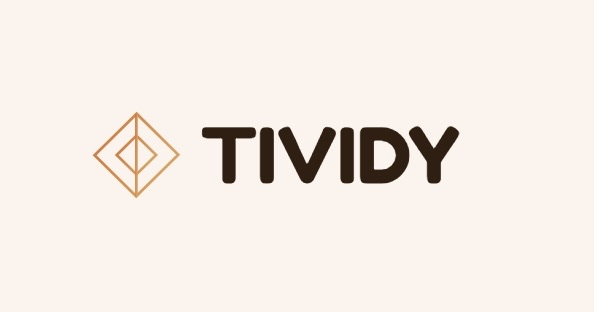
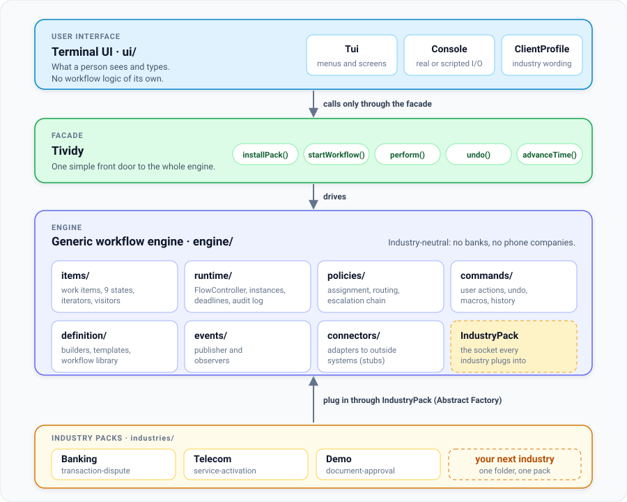
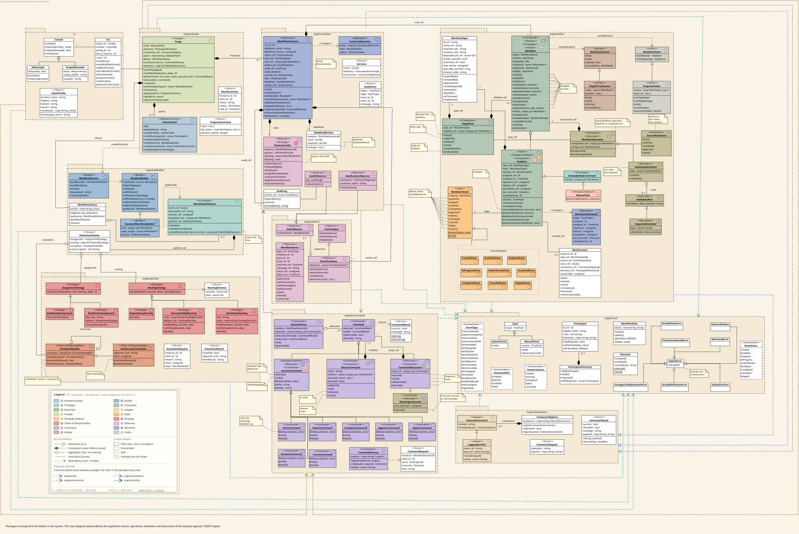

<h1 align="center">TIVIDY</h1>
<p align="center"><b>A generic workflow management engine in C++11, running two real industries</b><br/>
COS 214 Final Project · University of Pretoria · 2026</p>

<p align="center">
  <a href="https://github.com/jaymacaskill/tividy/actions/workflows/build.yml"></a>
  <a href="https://jaymacaskill.github.io/tividy/"></a>
  
  
</p>

<p align="center">
  
</p>

---

## 🧭 Where do you want to go?

| I want to... | Go here |
|---|---|
| **Read the whole report** | [Full report (PDF)](report/COS_214_Project_Report.pdf) |
| **Read just one deliverable** | [Report by deliverable](#-the-report-one-deliverable-at-a-time) |
| **See the diagrams** | [Diagrams](#-diagrams) |
| **Run it** | [Quick start](#-quick-start) |
| **See who did what** | [Team and roles](#-team-and-roles) |
| **Browse the code documentation** | [Doxygen docs](https://jaymacaskill.github.io/tividy/) |
| **See how we planned the build** | [Implementation plan](docs/misc/TIVIDY_Implementation_Plan.pdf) |
| **Work on the repo** | [CONTRIBUTING.md](CONTRIBUTING.md) |

---

## 💡 What is TIVIDY?

Many organisations run on *processes*: a set of steps, done by different people, in a certain order, with approvals, deadlines and "what if it goes wrong" paths. TIVIDY is a program that runs such processes. You describe the process once, and TIVIDY starts as many independent runs of it as you like, hands each step to the right person, keeps track of who did what, and moves things along when steps finish, fail or run out of time.

**What makes it a *generic engine*:** the engine itself knows nothing about banks or phone companies. Each industry is a plug-in "pack" that supplies its own steps, people, rules and look. The same engine runs both.

| Industry | Workflow | What it shows off |
|---|---|---|
| 🏦 **Banking** | `transaction-dispute`: a customer disputes a card transaction | Regulatory deadlines, provisional credit, a merchant who can answer or stay silent, a four-eyes decision and an appeal path |
| 📡 **Telecom** | `service-activation`: a new mobile or fibre order | Identity capture, an automatic credit check with a referral branch, a self-install versus technician fork, and a vendor that can fail |
| 📄 **Demo** | `document-approval` | A tiny pack that uses only engine classes, to show how little a new industry needs and how our generic engine gets re-imagined for an industry's needs |

Everything runs through an **interactive terminal interface (TUI)**: you start an instance, see who has work, act on it, watch routing and state changes, read the history, undo, and move simulated time forward to trigger deadlines.

---

## 🚀 Quick start

<p align="center">
  
</p>

**You need:** `g++` (C++11), `make`, and [GoogleTest 1.12.1](https://github.com/google/googletest/releases/tag/release-1.12.1) (the last release that supports C++11).  
**Optional:** `doxygen` + `graphviz` (docs), `valgrind` (leak checks), Docker (no local setup at all).

```bash
git clone https://github.com/jaymacaskill/tividy.git
cd tividy

make            # build the engine library and the app
make run        # start the interactive TUI
make test       # build and run every test file
```

**Prefer Docker?** The image pins Ubuntu 22.04, GCC 11 and GoogleTest 1.12.1, so it behaves the same everywhere (including right here, in browser, in this repo!)

```bash
make docker-run    # the TUI inside the container
make docker-test   # the test suite inside the container
```

| Command | What it does |
|---|---|
| `make` | Builds `build/libtividy.a` and the `tividy` executable |
| `make run` | Builds and starts the TUI |
| `make test` | Builds each `tests/*.cpp` as its own binary, runs them all, exits non-zero on any failure |
| `make valgrind` / `make valgrind-run` | Runs the tests / the TUI under Valgrind with leak checking |
| `make doxygen` | Generates the HTML documentation |
| `make docker-build` `docker-make` `docker-test` `docker-run` `docker-valgrind` `docker-valgrind-run` `docker-clean` | The same targets, inside the container |
| `make help`| A quick reminder of all the make commands |
| `make clean` | Removes `build/` |


### Trying both industries in the TUI

1. Run `make run`. The menu lists the installed workflows.
2. Pick **`transaction-dispute`** (Banking) or **`service-activation`** (Telecom). The screen's wording changes per industry because each pack brings its own vocabulary.
3. Choose who is acting, then act on the items that become available.
4. Open **history** to see every event, **progress** to see how far along you are, and **undo** to reverse an action.
5. Use **advance time** to jump ahead and watch deadlines lapse. In banking, leave the merchant silent to see the default decision; in telecom, switch on the `simulate_failures` data hook to see a vendor failure retried and escalated.

---

## 📄 The report, one deliverable at a time

The complete report is one PDF, but you rarely need all of it. Each part is also available on its own.

> [!TIP]
> Trying to get through everything in a hurry? Start with **Implementation overview**, **Design patterns** and **UML diagrams**.

| # | Deliverable | What's in it | Link |
|---|---|---|---|
| 1 | **Research** | Workflow concepts and the sources we used | [PDF](report/sections/01-research.pdf) |
| 2 | **System scope and boundaries** | What TIVIDY is, and is not | [PDF](report/sections/02-scope.pdf) |
| 3 | **Design rationale** | Why the engine is shaped the way it is | [PDF](report/sections/03-design-rationale.pdf) |
| 4 | **Requirements** | Functional, non-functional and deferred requirements | [PDF](report/sections/04-requirements.pdf) |
| 5 | **Industry workflows** | Telecom and Banking: participants, branching, failures, outcomes | [PDF](report/sections/05-industries.pdf) |
| 6 | **Implementation overview** | How an instance starts, runs, handles deadlines and how industries plug in | [PDF](report/sections/06-implementation.pdf) |
| 7 | **Design patterns** | All 16 patterns: GoF roles, classes and justification | [PDF](report/sections/07-patterns.pdf) |
| 8 | **UML diagrams** | Class, state, activity and sequence diagrams | [PDF](report/sections/08-uml-diagrams.pdf) |
| 9 | **GitHub workflow and evidence** | Branching, reviews, CI, Git evidence, build/run/test | [PDF](report/sections/09-github-workflow.pdf) |
| 10 | **Design decisions and revisions** | The decisions we made, what we changed and why | [PDF](report/sections/10-design-decisions.pdf) |
| 11 | **Team contributions** | Who did what | [README](#-team-and-roles) · [PDF](report/sections/11-contributions.pdf) |
| ★ | **Everything** | The complete report | [**Full report (PDF)**](report/COS_214_Project_Report.pdf) |

---

## 🏗️ How it's built
<p align="center">  </p>

- **Engine** (`engine/`) is industry-neutral: no banking or telecom words appear in it (we check with a `grep`).
- **Industry packs** (`industries/`) are plug-ins. Adding an industry means adding a folder and installing one pack. No engine file changes.
- **UI** (`ui/`) only talks to the engine through the `Tividy` facade.
- **Time is simulated**, so day-long deadlines can be demonstrated in seconds.

### 🎨 The 16 design patterns

All patterns are used to solve a real workflow problem.

| Category | Pattern | Where it lives |
|---|---|---|
| **Creational** | Abstract Factory | `IndustryPack` → `BankingPack`, `TelecomPack`, `DemoPack` |
| | Builder | `WorkflowBuilder`, `StandardWorkflowBuilder`, `WorkflowDirector` (one director per workflow) |
| | Prototype | `WorkItem::clone()`, `WorkflowDefinition::createInstance()` |
| **Structural** | Composite | `WorkItem` → `TaskItem` / `StageItem`; also `Command` → `MacroCommand` |
| | Decorator | `SecureWorkItem`, `ValidatedWorkItem`; `RetryingCommand` |
| | Adapter | `ExternalConnector` → `CoreBankingAdapter`, `CardSchemeAdapter`, `CreditBureauAdapter`, `NetworkProvisioningAdapter` |
| | Facade | `Tividy` |
| **Behavioural** | State | `TaskItem` + nine `WorkItemState` classes |
| | Template Method | `TaskItem::executeWork`, `InstanceCommand::execute`, `WorkflowDirector::build` |
| | Strategy | `AssignmentStrategy`, `RoutingStrategy` |
| | Observer | `EventPublisher` → `FlowController`, `AuditObserver`, `NotificationObserver` |
| | Command | `InstanceCommand` family, `ActionHistory`, `CommandFactory` |
| | Memento | `WorkItemMemento`, `InstanceMemento` |
| | Iterator | `DepthFirstIterator` |
| | Visitor | `ProgressVisitor` |
| | Chain of Responsibility | `EscalationHandler` → `RoleEscalationHandler` |

Full participant mappings and justifications: [Design patterns (PDF)](report/sections/07-patterns.pdf).

### ⭐ Beyond the brief

| Extra | What it gives you |
|---|---|
| **CI on every pull request** | GitHub Actions builds the Docker image and runs the whole test suite; PRs cannot merge if anything is red |
| **Docker and dev container** | Same toolchain everywhere; `make docker-run` needs nothing installed |
| **Valgrind leak checks** | `make valgrind` fails on definite or indirect leaks |
| **Doxygen on GitHub Pages** | [API docs](https://jaymacaskill.github.io/tividy/) redeploy automatically on every merge to `main` |
| **Automated PR hygiene** | Branch-name and PR-title checks, automatic labels, a PR template, and four required approvals |
| **Simulated clock** | Deadline behaviour is demonstrable live and testable in milliseconds |

*(Details and evidence: [GitHub workflow and evidence](report/sections/09-github-workflow.pdf).)*

---

## 📐 Diagrams

Every diagram is an SVG you can open directly, with its editable **Visual Paradigm** source linked underneath. All of them are drawn to match the final code and agree with each other. The full set is also in [`docs/img/final/`](docs/img/final/), and the Visual Paradigm files are located in [`docs/vpp`](docs/vpp).

### Class diagram

<p align="center">
  <a href="docs/img/final/class-diagram.svg"></a>
  <br/><sub>Complete system class diagram, colour-coded by pattern category</sub>
  <br/><a href="docs/vpp/class_diagram.vpp">Available in Visual Paradigm format</a>
</p>

### State diagram

<p align="center">
  <a href="docs/img/final/state-workitem-lifecycle.svg"></a>
  <br/><sub>The nine states of a work item and every legal transition</sub>
  <br/><a href="docs/vpp/state_workitem_lifecycle.vpp">Available in Visual Paradigm format</a>
</p>

### Activity diagrams

| Diagram | What it shows | SVG | Source |
|---|---|---|---|
| **1. Running an instance** | The generic engine loop: release work, assign it, do it, route, finish | [SVG](docs/img/final/activity-1-run-instance.svg) | [Visual Paradigm](docs/vpp/activity_1_run_instance.vpp) |
| **2. Failure, deadline and escalation** | What the engine does when something fails or time runs out | [SVG](docs/img/final/activity-2-failure-escalation.svg) | [Visual Paradigm](docs/vpp/activity_2_failure_escalation.vpp) |
| **3. Banking dispute** | The scenario end to end, with appeals | [SVG](docs/img/final/activity-3-banking-dispute.svg) | [Visual Paradigm](docs/vpp/activity_3_banking_dispute.vpp) |
| **4. Telecom activation** | The second industry, same engine | [SVG](docs/img/final/activity-4-telecom-activation.svg) | [Visual Paradigm](docs/vpp/activity_4_telecom_activation.vpp) |

### Sequence diagrams

| Diagram | What it shows | SVG | Source |
|---|---|---|---|
| **1. Start a workflow** | From the menu to the first available work | [SVG](docs/img/final/sequence-1-start-workflow.svg) | [Visual Paradigm](docs/vpp/sequence_1_start_workflow.vpp) |
| **2. Take a user action** | Command, snapshot, state change and event reactions | [SVG](docs/img/final/sequence-2-user-action.svg) | [Visual Paradigm](docs/vpp/sequence_2_user_action.vpp) |
| **3. Deadline to escalation** | A lapsed deadline reaching the right approver | [SVG](docs/img/final/sequence-3-deadline-escalation.svg) | [Visual Paradigm](docs/vpp/sequence_3_deadline_escalation.vpp) |

---

## 👥 Team and roles

Seven people were involved in creating the engine. Each person owned particular design patterns (and wrote their tests), plus a share of the code. Every pull request needed approval from four teammates.

| Name | Student Number |
|---|---|
| Aidan du Bruyn | 25040104 |
| Connor Human | 22752154 |
| Ishmael Ngwasheng | 24642542 |
| Jay Macaskill | 25198387 |
| Keval Govind | 24904407 |
| Ruan van Tonder | 25284607 |
| Thabo Ngwabi | 24742512 |

### Contribution statements

Each member's statement of what they contributed to the whole project.

<details>
<summary><b>Aidan du Bruyn</b></summary>

*Contribution statement to be added.*

</details>

<details>
<summary><b>Connor Human</b></summary>

*Contribution statement to be added.*

</details>

<details>
<summary><b>Ishmael Ngwasheng</b></summary>

*Contribution statement to be added.*

</details>

<details>
<summary><b>Jay Macaskill</b></summary>

*Contribution statement to be added.*

</details>

<details>
<summary><b>Keval Govind</b></summary>

*Contribution statement to be added.*

</details>

<details>
<summary><b>Ruan van Tonder</b></summary>

*Contribution statement to be added.*

</details>

<details>
<summary><b>Thabo Ngwabi</b></summary>

*Contribution statement to be added.*

</details>

---

## 🛠️ How we worked

- **Plan:** the work was split into dependency-ordered phases so nobody waited on anyone: ([PDF](docs/misc/TIVIDY_Implementation_Plan.pdf)).
- **Process:** every change is a branch and a pull request with four approvals and green CI: [CONTRIBUTING.md](CONTRIBUTING.md).
- **Evidence:** commit history, closed pull requests and CI runs are in the [GitHub workflow and evidence](report/sections/09-github-workflow.pdf) section of the report.

---

## 🪞 Where we started: a reflection on Phase 1

<p align="center">
  
</p>

Our first submission (Practical 6) was research and design only, with no code. It gave us the shape of the problem, and much of it survived. A few things did not, and that is the useful part.

**What carried through**
- The core idea: a **workflow definition** is a reusable template, and every **instance** is an independent run built from it.
- Separating routing from assignment, and modelling the work-item lifecycle explicitly.
- The research and design rationale.

**What changed once we started building**
- **The scenario.** We began with *employee onboarding*. It was not industry-specific enough to show off a generic engine, so we replaced it with two genuine industries: banking disputes and telecom activation.
- **The patterns.** We grew from 15 to 16 (Abstract Factory arrived with the plug-in industry packs), and several roles moved as the code took shape.
- **The diagrams.** The Practical 6 diagrams were drawn before an engine existed. We redrew them all from the final code rather than patching them, which is why they now agree with each other and with the implementation.
- **The scope.** We cut the design to what could be built, tested and demonstrated well.

The original submission is kept for reference: [Practical 6 PDF](docs/archive/COS_214_PA_6.pdf) · [Phase 1 research](docs/research/pa6_task_1_research.pdf) · [old diagrams](docs/img/pa6/).

---

## 📁 Repository structure

```
tividy/
├── README.md
├── CONTRIBUTING.md
├── Makefile                  build, test, run, valgrind, doxygen, docker targets
├── Dockerfile                Ubuntu 22.04 + GCC 11 + GoogleTest 1.12.1
├── Doxyfile
├── app/                      main.cpp, the TUI entry point
├── include/                  public headers
│   ├── engine/               core · events · connectors · items · policies
│   │                         commands · definition · runtime · facade
│   ├── industries/           banking · telecom · demo
│   └── ui/
├── src/                      implementations (same layout as include/)
├── tests/                    GoogleTest files, one binary each
├── report/                   final PDF report and per-deliverable PDFs
├── docs/
│   ├── vpp/                  Visual Paradigm projects
│   ├── img/final/            final diagram SVGs
│   ├── img/pa6/              Practical 6 diagrams (archived)
│   ├── archive/              Practical 6 submission
│   ├── research/             initial research and bibliography
│   ├── assets/
│   ├── misc/
│   └──── TIVIDY_Implementation_Plan.pdf
├── .devcontainer/            Enables Docker to run in codespaces
└── .github/                  CI workflows, PR template, labeler
```

---

## 📚 Sources and credits

Workflow research is cited in the [research section](report/sections/01-research.pdf) (Workflow Management Coalition glossary, workflow patterns, BPMN 2.0.2 and others). Third-party dependencies: [GoogleTest](https://github.com/google/googletest) 1.12.1 (tests), [Doxygen](https://www.doxygen.nl/) (documentation), [Valgrind](https://valgrind.org/) (leak checks).

COS 214 (Software Modelling), University of Pretoria.
