<h1 align="center">TIVIDY</h1>
<p align="center"><b>A generic workflow management engine in C++11, running two real industries</b><br/>
COS 214 Final Project · University of Pretoria · 2026</p>

<p align="center">
  <a href="https://github.com/jaymacaskill/tividy/actions/workflows/build.yml"></a>
  <a href="https://jaymacaskill.github.io/tividy/"></a>
  
  
</p>

<p align="center">
  
</p>

---

## 🧭 Where do you want to go?

| I want to... | Go here |
|---|---|
| **Read the whole report** | [Full report (PDF)](report/COS_214_Project_Report.pdf) |
| **Read just one deliverable** | [Report by deliverable](#-the-report-one-deliverable-at-a-time) |
| **See the diagrams** | [Diagrams](#-diagrams) |
| **Flip through the 15 pattern diagrams** | [Pattern tour](#pattern-tour) |
| **Run it** | [Quick start](#-quick-start) |
| **See who did what** | [Team and roles](#-team-and-roles) |
| **Browse the code documentation** | [Doxygen docs](https://jaymacaskill.github.io/tividy/) |
| **See how we planned the build** | [Implementation plan](docs/misc/TIVIDY_Implementation_Plan.pdf) |
| **Work on the repo** | [CONTRIBUTING.md](CONTRIBUTING.md) |

---

## 💡 What is TIVIDY?

Many organisations run on *processes*: a set of steps, done by different people, in a certain order, with approvals, deadlines and "what if it goes wrong" paths. TIVIDY is a program that runs such processes. You describe the process once, and TIVIDY starts as many independent runs of it as you like, hands each step to the right person, keeps track of who did what, and moves things along when steps finish, fail or run out of time.

**What makes it a *generic engine*:** the engine itself knows nothing about banks or phone companies. Each industry is a plug-in "pack" that supplies its own steps, people, rules and look. The same engine runs both.

| Industry | Workflow | What it shows off |
|---|---|---|
| 🏦 **Banking** | `transaction-dispute`: a customer disputes a card transaction | Regulatory deadlines, provisional credit, a merchant who can answer or stay silent, a four-eyes decision and an appeal path |
| 📡 **Telecom** | `service-activation`: a new mobile or fibre order | Identity capture, an automatic credit check with a referral branch, a self-install versus technician fork, and a vendor that can fail |
| 📄 **Demo** | `document-approval` | A tiny pack that uses only engine classes, to show how little a new industry needs and how our generic engine gets re-imagined for an industry's needs |

Everything runs through an **interactive terminal interface (TUI)**: you start an instance, see who has work, act on it, watch routing and state changes, read the history, undo, and move simulated time forward to trigger deadlines.

---

## 🚀 Quick start

<p align="center">
  
</p>

**You need:** `g++` (C++11), `make`, and [GoogleTest 1.12.1](https://github.com/google/googletest/releases/tag/release-1.12.1) (the last release that supports C++11).  
**Optional:** `doxygen` + `graphviz` (docs), `valgrind` (leak checks), Docker (no local setup at all).

```bash
git clone https://github.com/jaymacaskill/tividy.git
cd tividy

make            # build the engine library and the app
make run        # start the interactive TUI
make test       # build and run every test file
```

**Prefer Docker?** The image pins Ubuntu 22.04, GCC 11 and GoogleTest 1.12.1, so it behaves the same everywhere (including right here, in browser, in this repo!)

```bash
make docker-run    # the TUI inside the container
make docker-test   # the test suite inside the container
```

### Pick a client or display mode

All of these start the same TUI with the same three workflows installed. They only change the logo and the colours you see first. Every one has a Docker twin: put `docker-` in front (for example `make docker-run-hudson`).

| Command | What you get |
|---|---|
| `make run` | The TUI with the default settings |
| `make run-demo` / `make run-tividy` | The TUI with the TIVIDY logo |
| `make run-hudson` | The TUI with the Hudson Bank (banking) logo |
| `make run-warped` | The TUI with the Warped (telecom) logo |
| `make run-nologo` | The TUI with no logo (`--no-logo`) |
| `make run-nocolour` | The TUI with colour switched off (`NO_COLOR=1`), handy for screenshots and plain terminals |

### All commands

| Command | What it does |
|---|---|
| `make` | Builds `build/libtividy.a` and the `tividy` executable |
| `make run` and the `run-*` targets above | Builds and starts the TUI |
| `make test` | Builds each `tests/*.cpp` as its own binary, runs them all, exits non-zero on any failure |
| `make valgrind` / `make valgrind-run` | Runs the tests / the TUI under Valgrind with leak checking |
| `make doxygen` | Generates the HTML documentation |
| `make docker-build` | Builds the development image (once) |
| `make docker-make` / `make docker-test` | `make` / `make test` inside the container |
| `make docker-run` and `docker-run-demo`, `-tividy`, `-hudson`, `-warped`, `-nologo`, `-nocolour` | The TUI inside the container |
| `make docker-valgrind` / `make docker-valgrind-run` | The Valgrind targets inside the container |
| `make docker-clean` | Removes the container build artefacts |
| `make help` | A quick reminder of all the make commands |
| `make clean` | Removes `build/` |

> [!NOTE]
> Docker builds go into `build-docker/` and a `tividy-docker` binary, so they never overwrite a native build. Use `make docker-clean` to remove them and `make clean` for the native `build/` folder.

### Trying both industries in the TUI

1. Run `make run-hudson` (or `make run-warped`, or plain `make run`). The menu lists the installed workflows.
2. Pick **`transaction-dispute`** (Banking) or **`service-activation`** (Telecom). The screen's wording changes per industry because each pack brings its own vocabulary.
3. Choose who is acting, then act on the items that become available.
4. Open **history** to see every event, **progress** to see how far along you are, and **undo** to reverse an action.
5. Use **advance time** to jump ahead and watch deadlines lapse. In banking, leave the merchant silent to see the default decision; in telecom, switch on the `simulate_failures` data hook to see a vendor failure retried and escalated.

---

## 📄 The report, one deliverable at a time

The complete report is one PDF, but you rarely need all of it. Each part is also available on its own.

> [!TIP]
> Trying to get through everything in a hurry? Start with **Implementation overview**, **Design patterns** and **UML diagrams**.

| # | Deliverable | What's in it | Link |
|---|---|---|---|
| 1 | **Research** | Workflow concepts and the sources we used | [PDF](report/sections/01-research.pdf) |
| 2 | **System scope and boundaries** | What TIVIDY is, and is not | [PDF](report/sections/02-scope.pdf) |
| 3 | **Design rationale** | Why the engine is shaped the way it is | [PDF](report/sections/03-design-rationale.pdf) |
| 4 | **Requirements** | Functional, non-functional and deferred requirements | [PDF](report/sections/04-requirements.pdf) |
| 5 | **Industry workflows** | Telecom and Banking: participants, branching, failures, outcomes | [PDF](report/sections/05-industries.pdf) |
| 6 | **Implementation overview** | How an instance starts, runs, handles deadlines and how industries plug in | [PDF](report/sections/06-implementation.pdf) |
| 7 | **Design patterns** | All 16 patterns: GoF roles, classes and justification | [PDF](report/sections/07-patterns.pdf) |
| 8 | **UML diagrams** | Class, state, activity and sequence diagrams | [PDF](report/sections/08-uml-diagrams.pdf) |
| 9 | **GitHub workflow and evidence** | Branching, reviews, CI, Git evidence, build/run/test | [PDF](report/sections/09-github-workflow.pdf) |
| 10 | **Design decisions and revisions** | The decisions we made, what we changed and why | [PDF](report/sections/10-design-decisions.pdf) |
| 11 | **Team contributions** | Who did what | [README](#-team-and-roles) · [PDF](report/sections/11-contributions.pdf) |
| ★ | **Everything** | The complete report | [**Full report (PDF)**](report/COS_214_Project_Report.pdf) |

---

## 🏗️ How it's built
<p align="center">  </p>

- **Engine** (`engine/`) is industry-neutral: no banking or telecom words appear in it (we check with a `grep`).
- **Industry packs** (`industries/`) are plug-ins. Adding an industry means adding a folder and installing one pack. No engine file changes.
- **UI** (`ui/`) only talks to the engine through the `Tividy` facade.
- **Time is simulated**, so day-long deadlines can be demonstrated in seconds.

### 🎨 The 16 design patterns

All patterns are used to solve a real workflow problem.

| Category | Pattern | Where it lives |
|---|---|---|
| **Creational** | Abstract Factory | `IndustryPack` → `BankingPack`, `TelecomPack`, `DemoPack` |
| | Builder | `WorkflowBuilder`, `StandardWorkflowBuilder`, `WorkflowDirector` (one director per workflow) |
| | Prototype | `WorkItem::clone()`, `WorkflowDefinition::createInstance()` |
| **Structural** | Composite | `WorkItem` → `TaskItem` / `StageItem`; also `Command` → `MacroCommand` |
| | Decorator | `SecureWorkItem`, `ValidatedWorkItem`; `RetryingCommand` |
| | Adapter | `ExternalConnector` → `CoreBankingAdapter`, `CardSchemeAdapter`, `CreditBureauAdapter`, `NetworkProvisioningAdapter` |
| | Facade | `Tividy` |
| **Behavioural** | State | `TaskItem` + nine `WorkItemState` classes |
| | Template Method | `TaskItem::executeWork`, `InstanceCommand::execute`, `WorkflowDirector::build` |
| | Strategy | `AssignmentStrategy`, `RoutingStrategy` |
| | Observer | `EventPublisher` → `FlowController`, `AuditObserver`, `NotificationObserver` |
| | Command | `InstanceCommand` family, `ActionHistory`, `CommandFactory` |
| | Memento | `WorkItemMemento`, `InstanceMemento` |
| | Iterator | `DepthFirstIterator` |
| | Visitor | `ProgressVisitor` |
| | Chain of Responsibility | `EscalationHandler` → `RoleEscalationHandler` |

Full participant mappings and justifications: [Design patterns (PDF)](report/sections/07-patterns.pdf).

### ⭐ Beyond the brief

| Extra | What it gives you |
|---|---|
| **CI on every pull request** | GitHub Actions builds the Docker image and runs the whole test suite; PRs cannot merge if anything is red |
| **Docker and dev container** | Same toolchain everywhere; `make docker-run` needs nothing installed |
| **Valgrind leak checks** | `make valgrind` fails on definite or indirect leaks |
| **Doxygen on GitHub Pages** | [API docs](https://jaymacaskill.github.io/tividy/) redeploy automatically on every merge to `main` |
| **Automated PR hygiene** | Branch-name and PR-title checks, automatic labels, a PR template, and four required approvals |
| **Simulated clock** | Deadline behaviour is demonstrable live and testable in milliseconds |

*(Details and evidence: [GitHub workflow and evidence](report/sections/09-github-workflow.pdf).)*

---

## 📐 Diagrams

Every diagram is an SVG you can open directly, with its editable **Visual Paradigm** source linked underneath. All of them are drawn to match the final code and agree with each other. The full set is also in [`docs/img/final/`](docs/img/final/), and the Visual Paradigm files are located in [`docs/vpp`](docs/vpp).

### Class diagrams

There are four class diagrams: one for the industry-neutral engine, then one for each industry pack. Every diagram has its own legend, and colour shows which design pattern a class belongs to. In the industry diagrams, a **solid border** is that industry's own class and a **dashed border** is an engine class shown for context. All four live in one Visual Paradigm project: [`class_diagram.vpp`](docs/vpp/class_diagram.vpp).

#### The engine

<p align="center">
  <a href="docs/img/final/class-diagram.svg"></a>
  <br/><sub>The whole engine, with one package per folder. Click to open at full size.</sub>
</p>

#### The industry packs

Each pack is shown under the logo of the fictional client it was built for.

##### 🏦 Banking: `transaction-dispute`

<p align="center">
  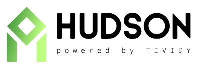
  <br/>
  <a href="docs/img/final/banking-class-diagram.svg">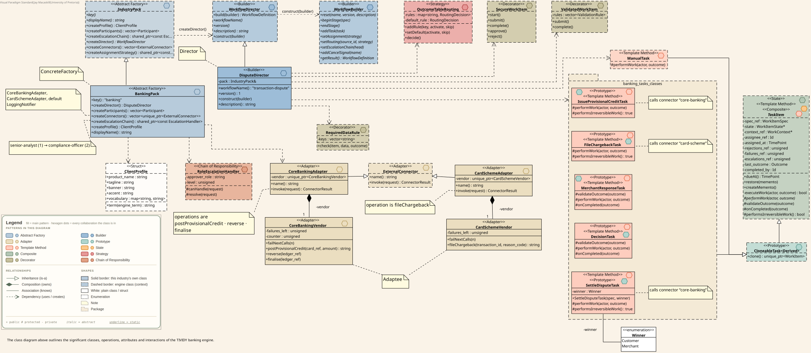</a>
  <br/><sub>Hudson Bank: <code>BankingPack</code>, <code>DisputeDirector</code>, the dispute tasks and the core-banking and card-scheme adapters</sub>
</p>

##### 📡 Telecom: `service-activation`

<p align="center">
  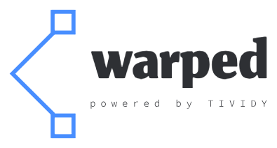
  <br/>
  <a href="docs/img/final/telecom-class-diagram.svg">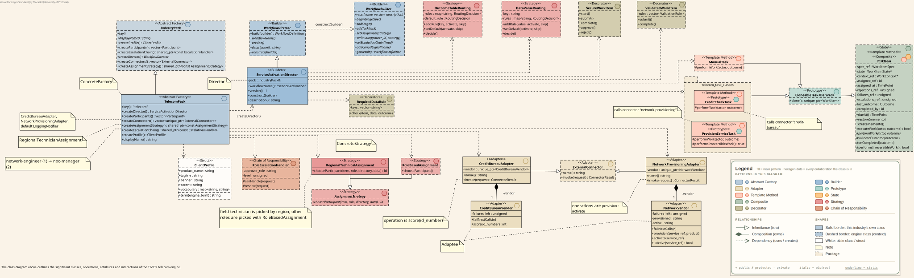</a>
  <br/><sub>Warped: <code>TelecomPack</code>, <code>ServiceActivationDirector</code>, the credit-check and provisioning tasks, the regional technician strategy and the vendor adapters</sub>
</p>

##### 📄 Demo: `document-approval`

<p align="center">
  
  <br/>
  <a href="docs/img/final/demo-class-diagram.svg">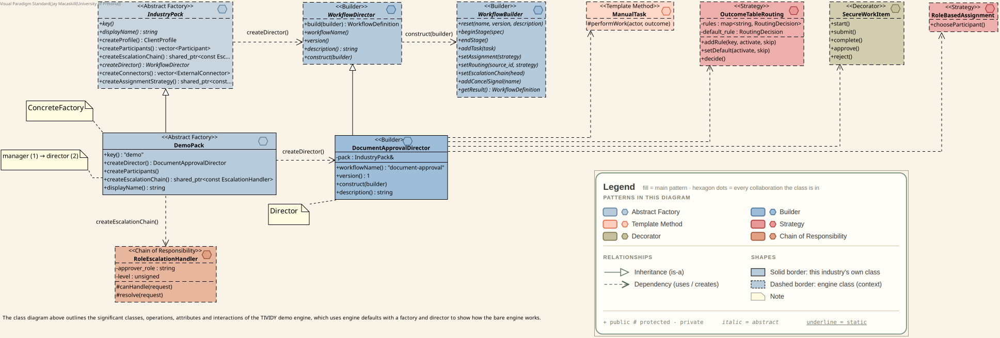</a>
  <br/><sub>The smallest pack: <code>DemoPack</code> and <code>DocumentApprovalDirector</code> use only engine classes</sub>
</p>

### State diagram

<p align="center">
  <a href="docs/img/final/state_workitem_lifecycle.svg">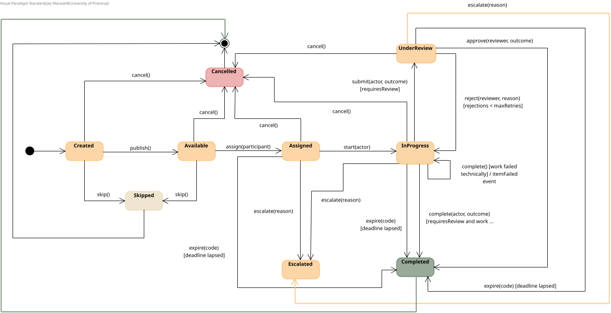</a>
  <br/><sub>The nine states of a work item and every legal transition</sub>
  <br/><a href="docs/vpp/state_workitem_lifecycle.vpp">Available in Visual Paradigm format</a>
</p>

### Activity diagrams

| Diagram | What it shows | SVG | Source |
|---|---|---|---|
| **1. Running an instance** | The generic engine loop: release work, assign it, do it, route, finish | [SVG](docs/img/final/activity-1-run-instance.svg) | [Visual Paradigm](docs/vpp/activity_1_run_instance.vpp) |
| **2. Failure, deadline and escalation** | What the engine does when something fails or time runs out | [SVG](docs/img/final/activity-2-failure-escalation.svg) | [Visual Paradigm](docs/vpp/activity_2_failure_escalation.vpp) |
| **3. Banking dispute** | The scenario end to end, with appeals | [SVG](docs/img/final/activity-3-banking-dispute.svg) | [Visual Paradigm](docs/vpp/activity_3_banking_dispute.vpp) |
| **4. Telecom activation** | The second industry, same engine | [SVG](docs/img/final/activity-4-telecom-activation.svg) | [Visual Paradigm](docs/vpp/activity_4_telecom_activation.vpp) |

### Sequence diagrams

| Diagram | What it shows | SVG | Source |
|---|---|---|---|
| **1. Start a workflow** | From the menu to the first available work | [SVG](docs/img/final/sequence-1-start-workflow.svg) | [Visual Paradigm](docs/vpp/sequence_1_start_workflow.vpp) |
| **2. Take a user action** | Command, snapshot, state change and event reactions | [SVG](docs/img/final/sequence-2-user-action.svg) | [Visual Paradigm](docs/vpp/sequence_2_user_action.vpp) |
| **3. Deadline to escalation** | A lapsed deadline reaching the right approver | [SVG](docs/img/final/sequence-3-deadline-escalation.svg) | [Visual Paradigm](docs/vpp/sequence_3_deadline_escalation.vpp) |

### Pattern tour

<p align="center">
  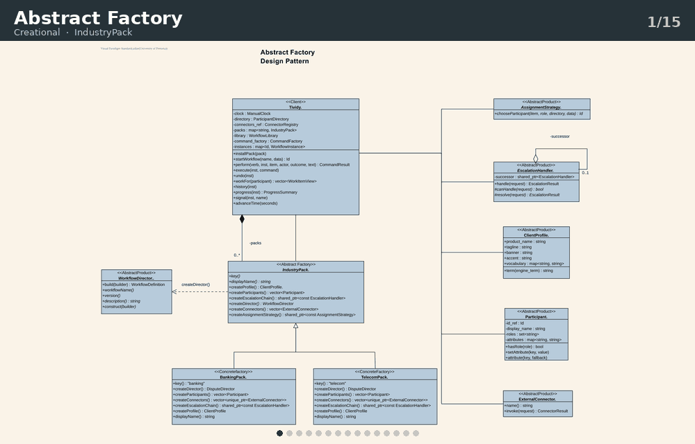
</p>

The slideshow steps through each pattern diagram (a few seconds each). Open any pattern below for the full-size diagram and a short why, what and how.

<details>
<summary><b>Abstract Factory</b> · Creational · `IndustryPack`</summary>

<p align="center">
  <a href="docs/img/final/abstract-factory-diagram.svg">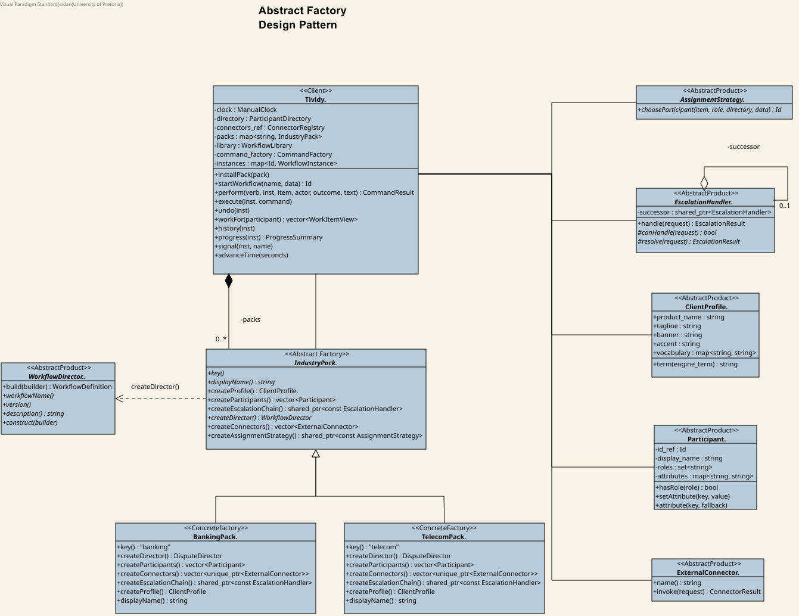</a>
</p>

**Why:** Each industry needs a matching family of parts that must never be mixed.  
**How:** A pack creates its own director, participants, connectors, escalation chain and look together.

</details>

<details>
<summary><b>Builder</b> · Creational · `WorkflowDirector`, `StandardWorkflowBuilder`</summary>

<p align="center">
  <a href="docs/img/final/builder-diagram.svg">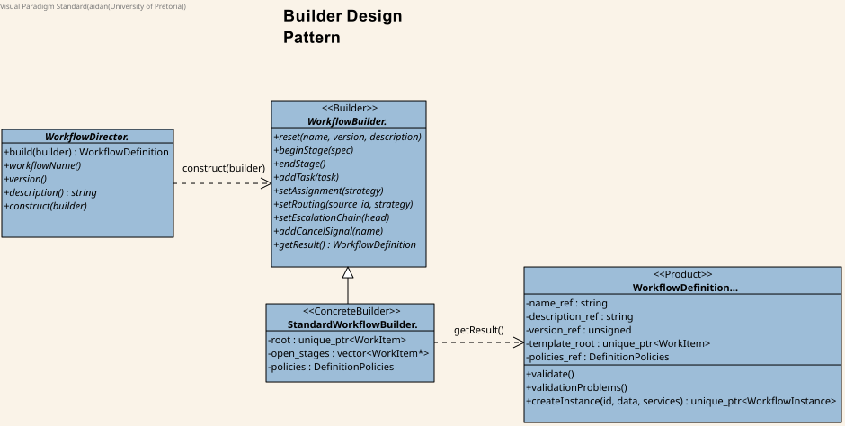</a>
</p>

**Why:** A workflow definition is too complex to build in one constructor.  
**How:** The director knows the recipe and the builder adds stages and tasks step by step.

</details>

<details>
<summary><b>Prototype</b> · Creational · `WorkflowDefinition::createInstance()`</summary>

<p align="center">
  <a href="docs/img/final/protorype-diagram.svg">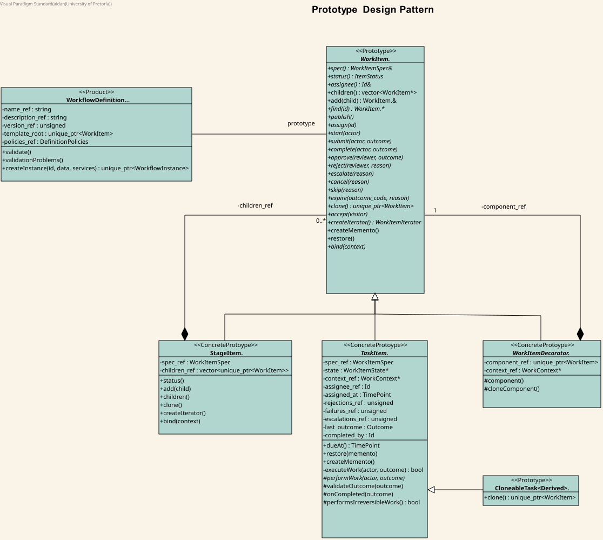</a>
</p>

**Why:** Every run needs its own private copy of the workflow.  
**How:** The definition is validated, then its whole tree is cloned, so instances never share data.

</details>

<details>
<summary><b>Composite</b> · Structural · `WorkItem`, `StageItem`, `TaskItem`</summary>

<p align="center">
  <a href="docs/img/final/composite-diagram.svg">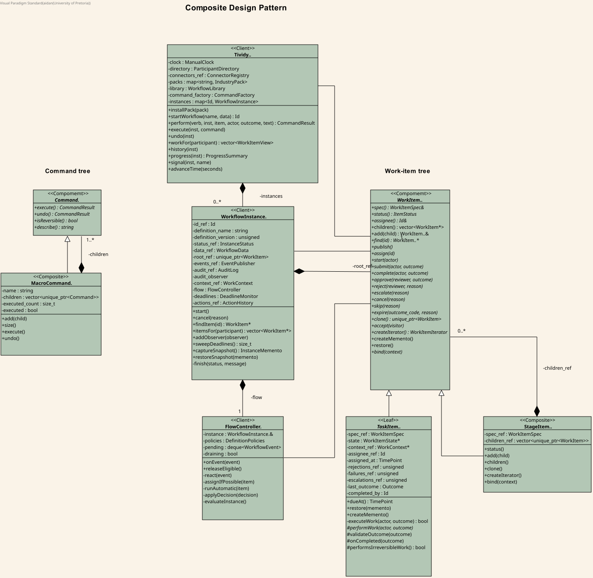</a>
</p>

**Why:** Work is nested, and callers should not care whether they hold one task or a whole stage.  
**How:** Stages and tasks are both work items, so they are treated the same way.

</details>

<details>
<summary><b>Decorator</b> · Structural · `SecureWorkItem`, `ValidatedWorkItem`</summary>

<p align="center">
  <a href="docs/img/final/decorator-diagram.svg">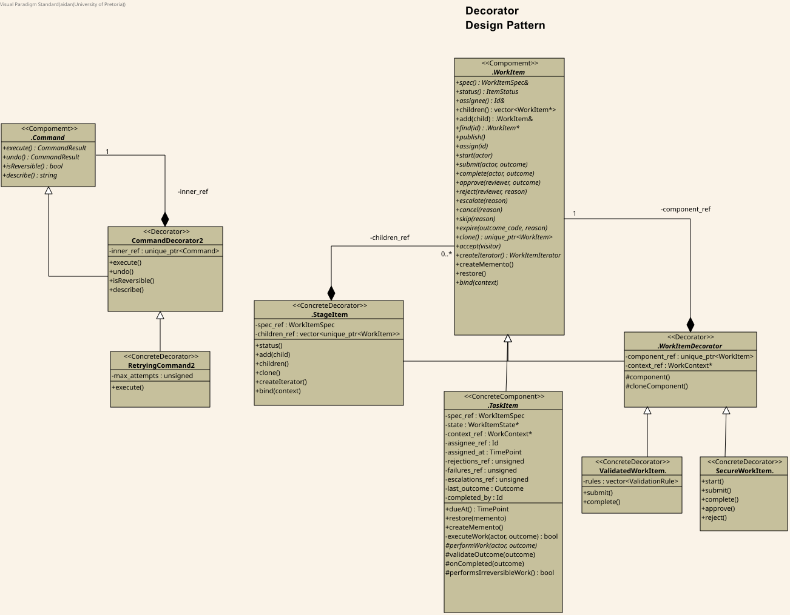</a>
</p>

**Why:** We want extra rules without editing every task.  
**How:** A decorator wraps a task and checks the role or the data before the real work runs.

</details>

<details>
<summary><b>Adapter</b> · Structural · `ExternalConnector`</summary>

<p align="center">
  <a href="docs/img/final/adapter-diagram.svg">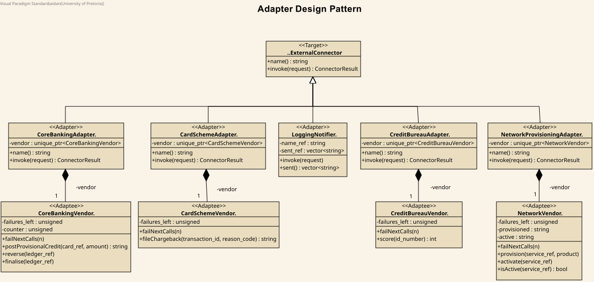</a>
</p>

**Why:** Outside systems all speak differently.  
**How:** Each vendor sits behind one connector interface, so tasks call them the same way.

</details>

<details>
<summary><b>Facade</b> · Structural · `Tividy`</summary>

<p align="center">
  <a href="docs/img/final/facade-diagram.svg">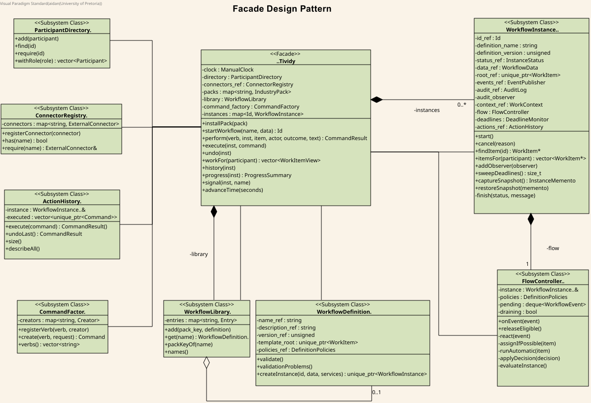</a>
</p>

**Why:** The UI should not need to know the engine's insides.  
**How:** One front door installs packs, starts workflows, performs actions, undoes and reports progress.

</details>

<details>
<summary><b>State</b> · Behavioural · `TaskItem` + nine `WorkItemState` classes</summary>

<p align="center">
  <a href="docs/img/final/state-diagram.svg">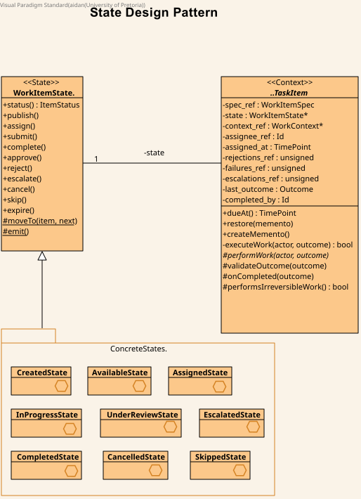</a>
</p>

**Why:** What a task may do depends on where it is in its life.  
**How:** Each of the nine states is a class, so an illegal move is refused in one place.

</details>

<details>
<summary><b>Template Method</b> · Behavioural · `TaskItem::executeWork`</summary>

<p align="center">
  <a href="docs/img/final/template-method-diagram.svg">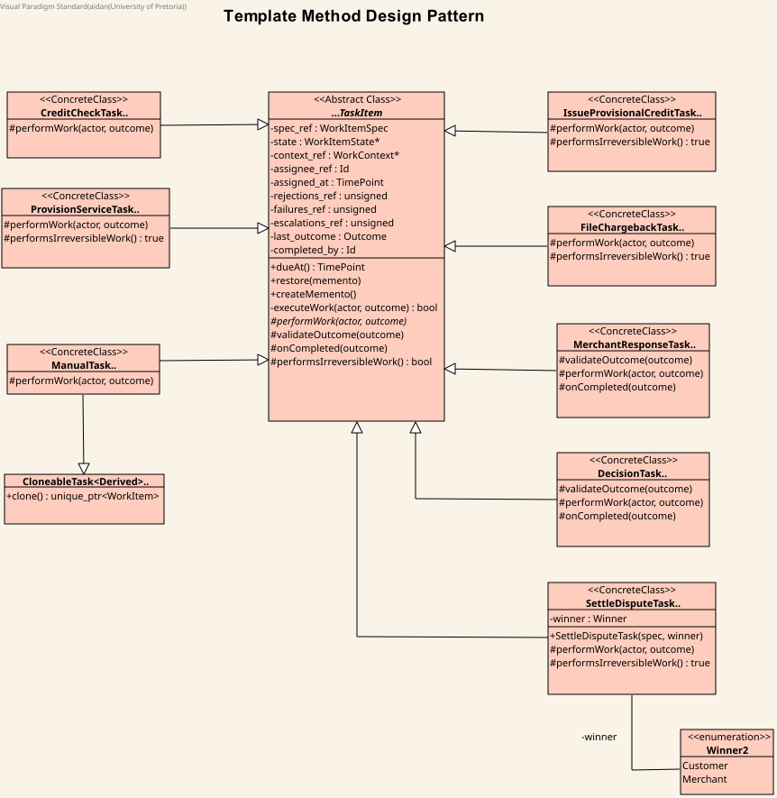</a>
</p>

**Why:** Every task must follow the same safe sequence.  
**How:** The base class fixes the steps and each task fills in only `performWork`.

</details>

<details>
<summary><b>Observer</b> · Behavioural · `EventPublisher`, `FlowController`, `AuditObserver`</summary>

<p align="center">
  <a href="docs/img/final/observer-diagram.svg">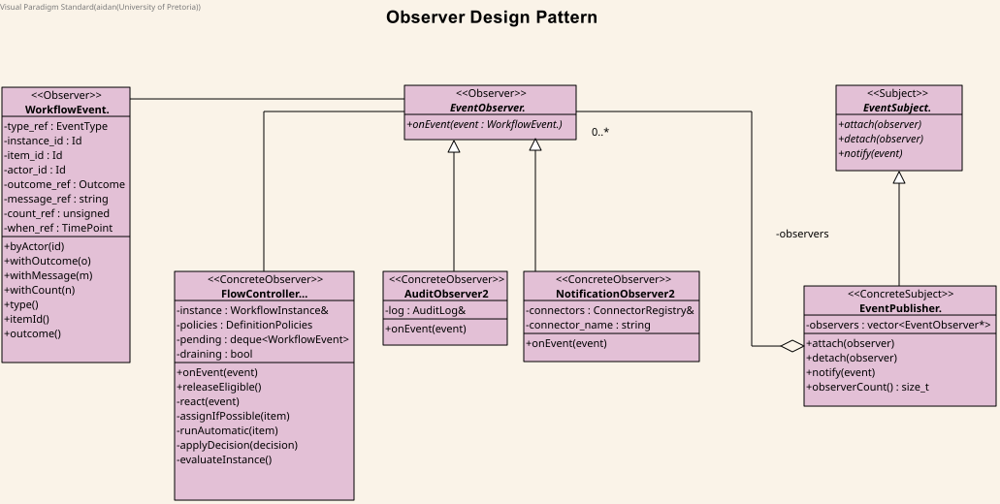</a>
</p>

**Why:** The audit log and the flow controller should not be wired into tasks.  
**How:** Items publish events, and any number of listeners react.

</details>

<details>
<summary><b>Command</b> · Behavioural · `InstanceCommand`, `ActionHistory`</summary>

<p align="center">
  <a href="docs/img/final/command-diagram.svg">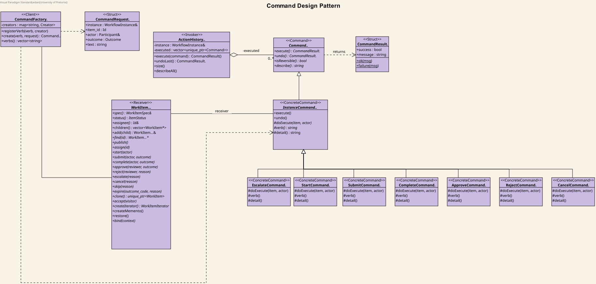</a>
</p>

**Why:** Users' actions must be recorded and undoable.  
**How:** Every action is an object run through the action history, and macros group several.

</details>

<details>
<summary><b>Memento</b> · Behavioural · `WorkItemMemento`, `InstanceMemento`</summary>

<p align="center">
  <a href="docs/img/final/memento-diagram.svg">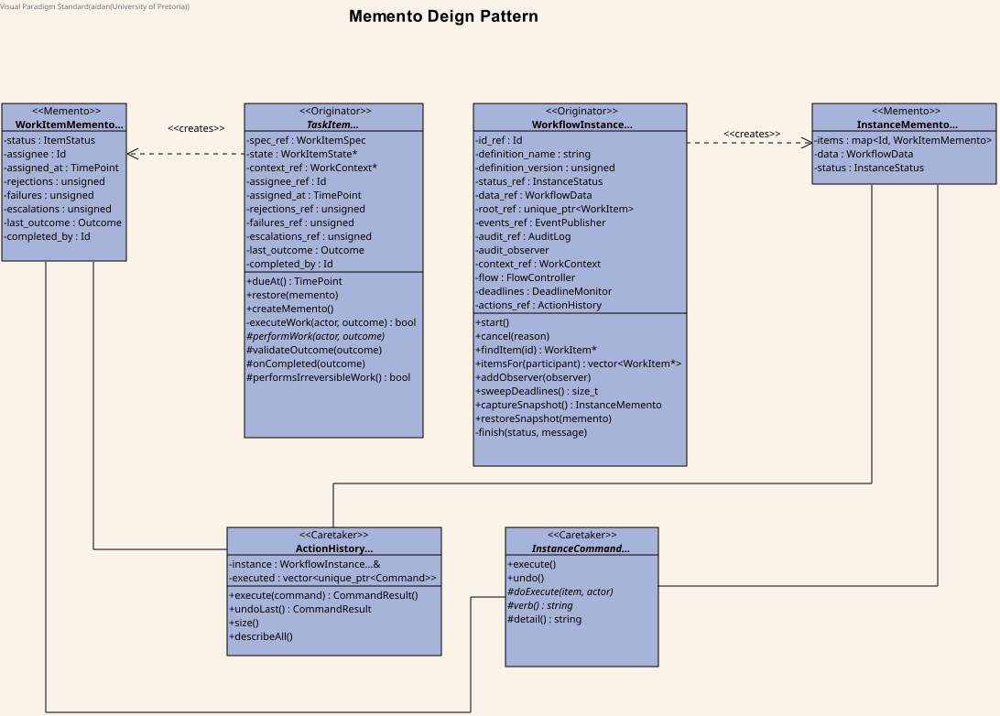</a>
</p>

**Why:** Undo needs the old state back without exposing internals.  
**How:** A snapshot is captured before a command and restored silently on undo.

</details>

<details>
<summary><b>Iterator</b> · Behavioural · `DepthFirstIterator`</summary>

<p align="center">
  <a href="docs/img/final/iterator-diagram.svg">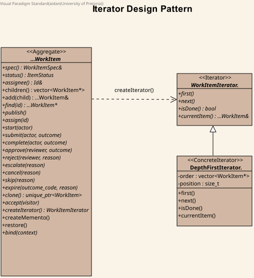</a>
</p>

**Why:** Callers need to visit every item without knowing the tree layout.  
**How:** The iterator hands out items one by one, depth first.

</details>

<details>
<summary><b>Visitor</b> · Behavioural · `ProgressVisitor`</summary>

<p align="center">
  <a href="docs/img/final/visitor-diagram.svg">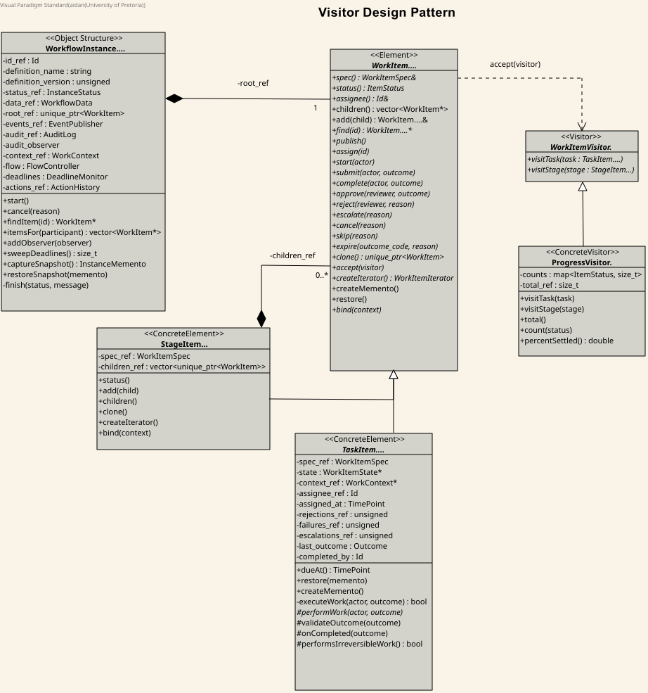</a>
</p>

**Why:** We want new reports without changing item classes.  
**How:** A visitor walks the tree and counts tasks by status.

</details>

<details>
<summary><b>Chain of Responsibility</b> · Behavioural · `EscalationHandler`, `RoleEscalationHandler`</summary>

<p align="center">
  <a href="docs/img/final/chain-of-responsibility-diagram.svg">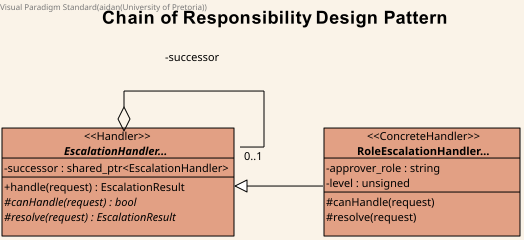</a>
</p>

**Why:** A stuck task needs the right level of authority, not everyone at once.  
**How:** Each handler tries it and passes it up if it cannot resolve it.

</details>

*Strategy (routing and assignment) has no standalone diagram yet. It appears in the engine class diagram below.*

---

## 👥 Team and roles

Seven people were involved in creating the engine. Each person owned particular design patterns (and wrote their tests), plus a share of the code. Every pull request needed approval from four teammates.

| Name | Student Number |
|---|---|
| Aidan du Bruyn | 25040104 |
| Connor Human | 22752154 |
| Ishmael Ngwasheng | 24642542 |
| Jay Macaskill | 25198387 |
| Keval Govind | 24904407 |
| Ruan van Tonder | 25284607 |
| Thabo Ngwabi | 24742512 |

### Contribution statements

Each member's statement of what they contributed to the whole project.

<details>
<summary><b>Aidan du Bruyn</b></summary>

**Planning.** I defined the original project scenario, employee onboarding, before an industry was required. I wrote its definition, worked out the roles and participants, and drew its activity diagram. When the brief changed to require a real industry, we replaced onboarding with banking and telecom.

**Implementation.** I implemented the work-item state machine, `WorkItemState` and its helper functions, and fixed the state transitions as the integration tests exposed problems. I also wrote `CommandDecorator` and `RetryingCommand`, `WorkItemValidation` (including `ValidatedWorkItem`), `WorkflowLibrary`, and `CommandFactory`. For the industry packs, I wrote the factory methods for `BankingPack` and `TelecomPack`.

**Testing.** I wrote the tests for everything I implemented. I also wrote the test suites for the Chain of Responsibility and Template Method patterns, for `Command`, and for the `Tividy` facade.

**Diagrams.** I broke the engine class diagram into the 15 individual pattern-specific class diagrams in `docs/img/final/`, and committed them with the updated Visual Paradigm project. I also combined the UML diagrams into the single PDF for the report, and converted diagrams between file formats to help Jay.

</details>

<details>
<summary><b>Connor Human</b></summary>

My contributions to TIVIDY covered several areas including, project co-ordination and management, technical implementation of several design patterns, code reviews and quality assurance, integration and repository oversight and demo preparation.

Jay devised a phased implementation plan which I tracked group progress and co-ordinated their implementation responsibilities against. I then assisted members in understanding dependencies, blockers and outstanding tasks, communicated priorities and kept development work aligned with the deadlines set internally.

I was responsible for ensuring the correct implementation of Strategy, Facade, Command and Visitor and various methods across other shared patterns. Specifically I contributed to `FlowController` which is responsible for routing decisions, dependency resolution, task assignment and workflow completion evaluation. I integrated strategy into workflow execution and implemented industry pack installation and workflow startup in the Facade pattern. `MacroCommand` is responsible for sequential execution, undo nested commands and rollback and in concrete Commands I implemented 7 workflow commands. Lastly I committed `WorkContext` and `ProgressVisitor` which are responsible for shared services and workflow progress calculation respectively.

Reviewing and ensuring quality across PR’s was also a substantial portion of my contribution ensuring that our code was assessed from multiple points of consideration, meaning I also contributed unit tests and debugging.

Finally integration, repository oversight and demonstration preparation formed part of my responsibilities which saw me audit, track dependencies , co-ordinate resolution of blockers and identifying required testing across the repository.

</details>

<details>
<summary><b>Ishmael Ngwasheng</b></summary>

During the deciding and trial phases of the project I was responsible for Pattern mapping & justifications and Tracking of design decisions. This involves having to narrow down the best pattern for a particular problem in the generic structure of the TIVIDY project. I had to decide for and against other patterns which seem to do or even solve the same problem. This involved analyzing an entire TIVIDY scenario and associating each problem in the system to a suitable design pattern.

My contributions during the peak development phases of the TIVIDY project involved implementing core system functionality, applying software design patterns, and developing unit and integration tests. I worked on foundational components such as the Command, Memento, Template Method, and WorkItem structures, as well as runtime functionality including action history, deadline monitoring, and the `StageItem` composite. I also contributed to the Decorator pattern through the implementation of `WorkItemDecorator` and `SecureWorkItem`, alongside tests for the State and Iterator patterns. Additionally, I developed tests for work items, workflow definitions, and the demo industry, and implemented 12 operations in the Tividy facade to support command execution, undo functionality, work-item queries, history and progress reporting, event signalling, time management, and access to shared services.

</details>

<details>
<summary><b>Jay Macaskill</b></summary>

During foundational phases of the project, I was responsible for: core implementation; tooling; documentation and coordination of TIVIDY, including ensuring the presence of header files with Doxygen-style comments. Curated the repository automation through CI, Dockerised build tests, pull request templates and GitHub Actions to ensure the repository is predominantly self-managing, and all pull requests build and pass tests before a merge.

Implemented `engine/core` and `engine/events` packages and their unit tests and also implemented `Observers.cpp`. Provided elements of the implementation of the industry layer, including `BankingTasks.cpp`, `BankingDirector.cpp`, `BankingAdapters.cpp`, `TelecomCreditAdapter.cpp`, `TelecomNetworkAdapter.cpp`, `TelecomAssignment.cpp`, and `TelecomTasks.cpp` together with their necessary tests and a Banking pack smoke test.

Delivered the TUI implementation and an accompanying test suite. Used AI-assisted development and prompt design to produce a Python script that creates custom terminal-based logo art for client logos with fallbacks for terminals without colour support, and an 80-column limit; the art is compiled into the program, so nothing is read from disk at runtime. Handled the overall tooling and infrastructure of the project, including Dockerfile and its compatibility with GitHub Codespaces, CI workflows, the Doxygen documentation hosted on GitHub Pages, branch protection rules, `README.md` and `CONTRIBUTING.md` (which documents the team’s workflow). During the final phases of the project, I consolidated and finalised the project for submission.

Managed the assembly, review, consolidation and formatting of the final report, wrote the design rationale, functional/non-functional/deferred requirements used to guide testing, implementation explanation, industry definitions and workflow documentation for both the Banking industry (“Hudson Bank”) and the Telecom industry (“Warped”). Updated the pattern table to match the delivered system, delivered the final sequence and state diagrams and three of four activity diagrams. Delivered the accompanying slide deck for the live demonstration. Further collaborated with members to revise the final class diagrams to ensure that they reflected the project architecture and overall presentation quality.

Assisted in the coordination of the team throughout, tracking progress, reviewing code and pull requests, and delivering Phase 0 of the project to ensure all project foundations were adequate, thereafter providing a seven-phase implementation plan to assist with work distribution and availability for the team’s questions.

</details>

<details>
<summary><b>Keval Govind</b></summary>

My main responsibility in TIVIDY was Role E, covering Builder, Abstract Factory and Memento, together with supporting workflow-definition and task-execution functionality. I focused on the reusable engine components that allow workflows to be constructed, validated and restored across different industries. I coordinated shared work with teammates so that these components fitted their state-machine, runtime, command and industry implementations.

I implemented the workflow-definition core and structural validation. This included managing workflow metadata, ownership of the template structure and its policies, and detecting problems such as duplicate item IDs, empty stages, invalid dependencies and dependency cycles. I also checked review requirements, automatic-task constraints, deadlines and routing source IDs. Following team clarification, I kept routing-target validation within the runtime rather than extending the shared routing interface. This maintained the agreed separation between validating a reusable definition and checking decisions produced during execution.

For Builder, I implemented the standard workflow-building behaviour and contributed the shared `WorkflowDirector::build()` method. This allows directors to assemble nested stages, add tasks, configure policies and obtain a validated workflow definition. I paid particular attention to ownership, builder reuse and reset behaviour so that successive builds produce independent definitions. My Abstract Factory implementation contribution was the shared `IndustryPack` defaults, including notification, assignment and client-profile products. These defaults support the concrete industry packs developed by teammates while keeping the engine independent of industry-specific details.

My Memento contribution focused on instance-level snapshot capture and restoration. I implemented the collection of item mementos together with workflow data and instance status, allowing command undo to restore a consistent workflow state. Restoration preserves the existing runtime objects, services, observers and audit history. I also implemented the default state operations and shared task-execution behaviour, including validation, failure handling, outcome recording and reversibility bookkeeping.

During integration, I implemented an important correction for irreversible external effects. A task can now record an external commitment immediately, before later response processing might fail. This prevents an operation such as a successful banking transaction followed by a malformed response from being treated as safely reversible. The implementation records the barrier once per execution attempt and preserves it across snapshot restoration.

I supported these implementations with unit and integration tests, including eight formal Builder tests, eleven Memento tests and twenty-six Abstract Factory tests, as well as targeted irreversible-effect regressions. These cover ownership, invalid workflow structures, snapshot independence, rollback, undo boundaries and consistency between industry product families. I also addressed review feedback, reviewed teammates’ pull requests and helped identify dependency and integration issues. Throughout the project, I aimed to verify behaviour using the real collaborating implementations as they became available, rather than relying solely on isolated tests.

</details>

<details>
<summary><b>Ruan van Tonder</b></summary>

I was responsible for the consolidation of our class diagrams in the initial planning phase of the Tividy project. The requirement of industry was then added to the project, which caused me to revise the class diagram before our implementation began.

During the implementation phase, I was responsible for the testing of the Observer, Visitor and Command design patterns as well as the implementation of the `FlowController`, specifically the constructor, destructor and main functionality (along with Connor both by splitting implementation as planned and with Connor picking up some functionality in order to help me manage the work), `WorkflowInstance` (along with Keval by splitting functionality into definitions, snapshots and main functionality as planned) in the general Tividy system. I was also responsible for the `TelecomDirector` in the telecommunication scenario for Tividy (along with Aidan by splitting the Telcom functions as planned). I was also the lead on the runtime integration for the TIVIDY implementation.

</details>

<details>
<summary><b>Thabo Ngwabi</b></summary>

**Planning.** In the planning phase I drew the work-item state diagram and the generic activity diagrams.

**Implementation.** I implemented `TaskItem` and `ManualTask` (the base class for work items), `DepthFirstIterator` for the Iterator pattern, and `WorkflowDefinition::createInstance`, which clones a validated definition into an independent instance. I also implemented `InstanceCommand`, the base class for the engine's undoable instance actions, and `DemoPack`, the generic demo industry pack. While working on `TaskItem` I removed memento logic to avoid overlapping with the Memento work.

**Testing.** I wrote tests for the Adapter pattern covering the banking and telecom connectors, the Decorator pattern, workflow-definition instances and partial definitions, `InstanceCommand`, and the demo industry. I fixed the include and incomplete-type errors that were blocking the iterator and decorator tests.

</details>

---

## 🛠️ How we worked

- **Plan:** the work was split into dependency-ordered phases so nobody waited on anyone: ([PDF](docs/misc/TIVIDY_Implementation_Plan.pdf)).
- **Process:** every change is a branch and a pull request with four approvals and green CI: [CONTRIBUTING.md](CONTRIBUTING.md).
- **Evidence:** commit history, closed pull requests and CI runs are in the [GitHub workflow and evidence](report/sections/09-github-workflow.pdf) section of the report.

---

## 🪞 Where we started: a reflection on Phase 1

<p align="center">
  
</p>

Our first submission (Practical 6) was research and design only, with no code. It gave us the shape of the problem, and much of it survived. A few things did not, and that is the useful part.

**What carried through**
- The core idea: a **workflow definition** is a reusable template, and every **instance** is an independent run built from it.
- Separating routing from assignment, and modelling the work-item lifecycle explicitly.
- The research and design rationale.

**What changed once we started building**
- **The scenario.** We began with *employee onboarding*. It was not industry-specific enough to show off a generic engine, so we replaced it with two genuine industries: banking disputes and telecom activation.
- **The patterns.** We grew from 15 to 16 (Abstract Factory arrived with the plug-in industry packs), and several roles moved as the code took shape.
- **The diagrams.** The Practical 6 diagrams were drawn before an engine existed. We redrew them all from the final code rather than patching them, which is why they now agree with each other and with the implementation.
- **The scope.** We cut the design to what could be built, tested and demonstrated well.

The original submission is kept for reference: [Practical 6 PDF](docs/archive/COS_214_PA_6.pdf) · [Phase 1 research](docs/research/pa6_task_1_research.pdf) · [old diagrams](docs/img/pa6/).

---

## 📁 Repository structure

```
tividy/
├── README.md
├── CONTRIBUTING.md
├── Makefile                  build, test, run, valgrind, doxygen, docker targets
├── Dockerfile                Ubuntu 22.04 + GCC 11 + GoogleTest 1.12.1
├── Doxyfile
├── app/                      main.cpp, the TUI entry point
├── include/                  public headers
│   ├── engine/               core · events · connectors · items · policies
│   │                         commands · definition · runtime · facade
│   ├── industries/           banking · telecom · demo
│   └── ui/
├── src/                      implementations (same layout as include/)
├── tests/                    GoogleTest files, one binary each
├── report/                   final PDF report and per-deliverable PDFs
├── docs/
│   ├── vpp/                  Visual Paradigm projects
│   ├── img/final/            final diagram SVGs
│   ├── img/pa6/              Practical 6 diagrams (archived)
│   ├── archive/              Practical 6 submission
│   ├── research/             initial research and bibliography
│   ├── assets/
│   ├── misc/
│   └──── TIVIDY_Implementation_Plan.pdf
├── .devcontainer/            Enables Docker to run in codespaces
└── .github/                  CI workflows, PR template, labeler
```

---

## 📚 Sources and credits

Workflow research is cited in the [research section](report/sections/01-research.pdf) (Workflow Management Coalition glossary, workflow patterns, BPMN 2.0.2 and others). Third-party dependencies: [GoogleTest](https://github.com/google/googletest) 1.12.1 (tests), [Doxygen](https://www.doxygen.nl/) (documentation), [Valgrind](https://valgrind.org/) (leak checks).

COS 214 (Software Modelling), University of Pretoria.