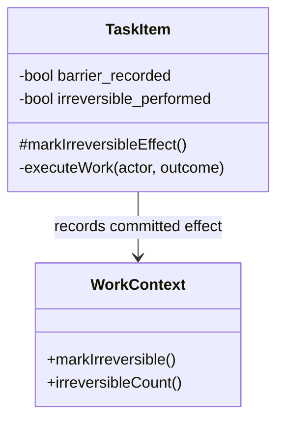

# Recording irreversible task effects

A successful external operation can commit an effect before its response is fully
validated. If response processing then throws, recording the barrier only after
performWork() returns would incorrectly leave that effect undoable.

Task subclasses call the protected markIrreversibleEffect() immediately after a
confirmed commit and before later processing that can fail. The helper increments
the WorkContext barrier and makes the task non-reversible. Repeated calls within
one execution attempt have no additional effect.

executeWork() resets the per-attempt barrier_recorded flag after validation and
before performWork(). Its existing performsIrreversibleWork() success path uses the
same helper, retaining compatibility without counting an early mark twice. A new
attempt can record a new effect even when an earlier attempt already committed one.

Both TaskItem constructors initialise the per-attempt flag to false. Prototype
copies remain fresh template instances. Runtime mementos do not restore this flag,
the sticky irreversible_performed flag, or the context barrier: restoring local
workflow state cannot undo an external effect.

The regression suite tests post-commit failures, idempotency, separate attempts,
pre-commit rejection, successful-work compatibility, Prototype copies, mementos
and real command-history undo barriers. These tests use normal task and connector
extensions with real production collaborators. Industry tasks must adopt the
early call at their own commit points; the engine cannot infer an external commit
from a failure alone.

